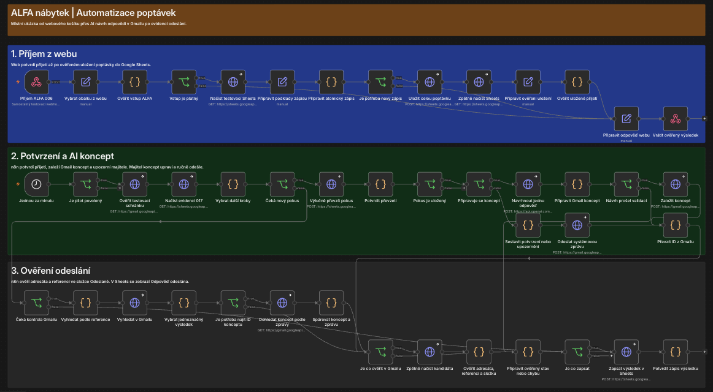

# ALFA nábytek · automatizace poptávek v n8n

Zákazník odešle poptávku z webového košíku. Automatizace ji uloží do Google Sheets, potvrdí přijetí a připraví koncept odpovědi v Gmailu. Majitel koncept zkontroluje, případně upraví a sám odešle. n8n ověří odeslanou zprávu a aktualizuje stav poptávky v evidenci.



## Co jsem řešil

- **Příjem z webu.** Web dostane potvrzení po ověřeném zápisu do Google Sheets. Opakovaný požadavek se stejným ID vrátí původní potvrzení.
- **Návrh odpovědi.** Pokud v poptávce chybí podklady, AI navrhne doplňující otázku. Majitel dostane odkaz na koncept v Gmailu.
- **Opakování a výpadky.** Workflow nejdřív rezervuje pokus v evidenci. Po nejasném výsledku dohledává existující zprávu nebo koncept. Nejednoznačný výsledek předá k ruční kontrole.
- **Ověření odeslání.** Stav „Odpověď odeslána“ vznikne po ověření adresáta, reference poptávky a složky Odeslané.

## Ukázka bez přístupů

Fiktivní zákazník poptává jednací stůl pro čtyři osoby a vynechá rozměry. [Lokální ukázka](demo.mjs) spustí vybrané uzly ze skutečného exportu s připravenými odpověďmi AI, Sheets a Gmailu. Vypíše návrh konceptu a ověří, jak se workflow zachová při odmítnuté rezervaci, špatném adresátovi, chybné referenci a správně odeslané zprávě.

```sh
node demo.mjs
```

Stačí Node.js. Ukázka běží bez sítě a používá fiktivní data.

## Plátno v n8n

[Workflow JSON](workflow.json) je anonymizovaná kopie 49 uzlů z místního testovacího workflow. V editoru n8n ji lze otevřít přes **⋯ → Import from File**. Export slouží k prohlídce plátna. Původní živý průchod se samostatnou testovací evidencí a testovacím Gmailem byl ověřen v listopadu 2026 včetně změny stavu po ručním odeslání. [Dokumentace importu](https://docs.n8n.io/workflows/export-import/)

**Technologie** · n8n, Next.js, TypeScript, Google Sheets, Gmail, OpenAI.
