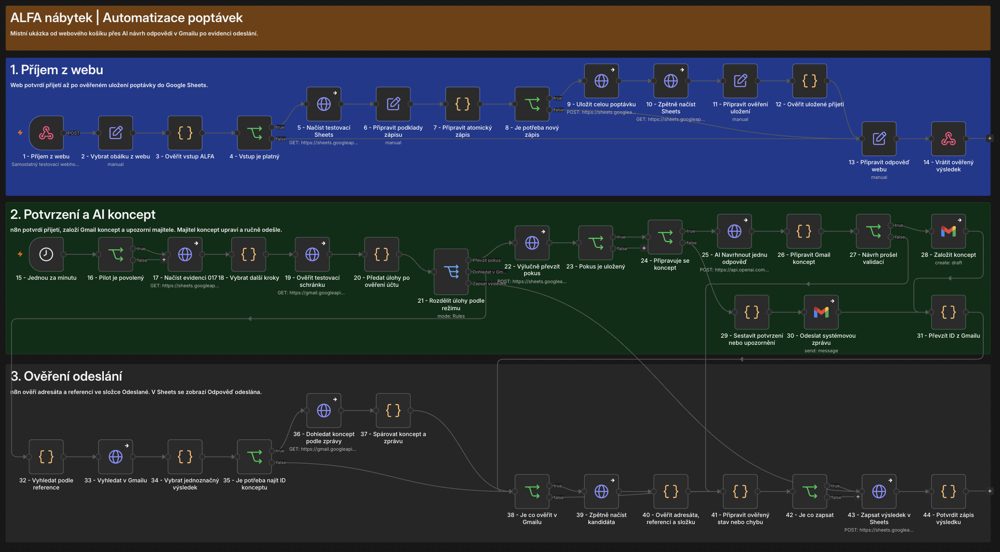

# ALFA nábytek · automatizace poptávek v n8n

Zákazník odešle poptávku z webového košíku. Automatizace ji uloží do Google Sheets, potvrdí přijetí a připraví koncept odpovědi v Gmailu. Majitel koncept zkontroluje, případně upraví a sám odešle. n8n ověří odeslanou zprávu a aktualizuje stav poptávky v evidenci.



## Co jsem řešil

- **Příjem z webu.** Web dostane potvrzení po ověřeném zápisu do Google Sheets. Opakovaný požadavek se stejným ID vrátí původní potvrzení.
- **Návrh odpovědi.** Pokud v poptávce chybí podklady, AI navrhne doplňující otázku. Majitel dostane odkaz na koncept v Gmailu.
- **Rozdělení úloh.** Jeden uzel Switch směruje nový pokus, dohledání v Gmailu nebo zápis výsledku. Plánovač ověřuje Gmail účet až tehdy, když má úlohu ke zpracování. Vestavěné Gmail uzly zakládají koncepty a odesílají systémové zprávy.
- **Opakování a výpadky.** Workflow nejdřív rezervuje pokus v evidenci. Po nejasném výsledku dohledává existující zprávu nebo koncept. Nejednoznačný výsledek předá k ruční kontrole.
- **Ověření odeslání.** Stav „Odpověď odeslána“ vznikne po ověření adresáta, reference poptávky a složky Odeslané.

## Vyzkoušejte si workflow v n8n

[**Stáhnout demo-workflow.json**](demo-workflow.json) · vlastní n8n · bez přístupů ke Googlu a OpenAI

1. Stáhněte `demo-workflow.json` přes **Download raw file**. V novém prázdném workflow n8n zvolte **⋯ → Import from File** a vyberte stažený soubor.
2. Otevřete uzel **Upravit zadání**. Výchozí scénář `chybi_rozmery` můžete rovnou ponechat; lze změnit i jméno, položku, poznámku a rozměry. E-mail musí být fiktivní s koncovkou `.test`.
3. Klikněte na **Execute workflow**. Workflow není potřeba publikovat ani připojovat k účtům.
4. Otevřete **Výsledek ukázky → OUTPUT → JSON**. Zobrazí se potvrzení přijetí, text konceptu a výsledný stav evidence. V předchozích uzlech si můžete prohlédnout jednotlivé kroky.

Změňte pole `scenar` v uzlu **Upravit zadání** a spusťte workflow znovu:

| Hodnota `scenar` | Co ukázka provede | Výsledný stav |
| --- | --- | --- |
| `chybi_rozmery` | Připraví koncept s otázkou na chybějící rozměry. | **Koncept připraven** |
| `spravna_odpoved` | Navíc simuluje ruční odeslání majitelem a ověří zprávu. | **Odpověď odeslána** |
| `chybny_adresat` | Simulovaná zpráva má jiného adresáta. Ověření ji odmítne. | **Ruční kontrola** |

Zkuste také vyplnit `rozmery`, například `160 × 80 cm`: připravená odpověď už se na ně nebude ptát. Návrh textu používá jednoduchou šablonu, nikoli živý AI model. Poznámka se objeví v rekapitulaci; šablona její obsah jazykově nevyhodnocuje.

Uzly **Připravit Gmail koncept** a **Ověřit odeslanou zprávu** vykonávají kód ze skutečného exportu. Uzly označené **mock** nahrazují vnější služby. Nic se nezapisuje do Google Sheets ani neodesílá e-mailem. Každý běh začíná od začátku; demo neověřuje trvalé ukládání, souběh ani celý provozní plánovač. Prohlížení repozitáře samo workflow nespustí; k této ukázce potřebujete vlastní n8n.

## Kontroly v terminálu

Fiktivní zákazník poptává jednací stůl pro čtyři osoby a vynechá rozměry. [Lokální ukázka](demo.mjs) spustí vybrané kontroly ze skutečného exportu s připravenými odpověďmi AI, Sheets a Gmailu. Vypíše návrh konceptu a ověří odmítnutou rezervaci, dohledání konceptu po nejasné odpovědi Gmailu i rozpoznání správně odeslané zprávy.

```sh
node demo.mjs
```

Stačí Node.js. Ukázka běží bez sítě a používá fiktivní data.

Mock workflow lze znovu sestavit z aktuálního anonymizovaného exportu a ověřit bez sítě:

```sh
node build-demo-workflow.mjs
node --test demo-workflow.test.mjs
```

Všechny tři scénáře byly ověřené v n8n **2.44.6** v jednorázových kontejnerech bez sítě. Prošlo také 12 lokálních kontrol, včetně změny vstupních údajů, chybné reference a zprávy, která zůstala pouze konceptem.

## Plátno v n8n

[Workflow JSON](workflow.json) je anonymizovaný export se 44 očíslovanými pracovními uzly a čtyřmi poznámkami. V editoru n8n ho lze otevřít přes **⋯ → Import from File**. Export slouží k prohlídce plátna. Živý průchod předchozí verze ověřil změnu stavu po ručním odeslání. Vestavěné Gmail uzly v této verzi prošly zkouškou se smyšlenými odpověďmi a simulovaným timeoutem. [Dokumentace importu](https://docs.n8n.io/workflows/export-import/)

**Technologie** · n8n, Next.js, TypeScript, Google Sheets, Gmail, OpenAI.
